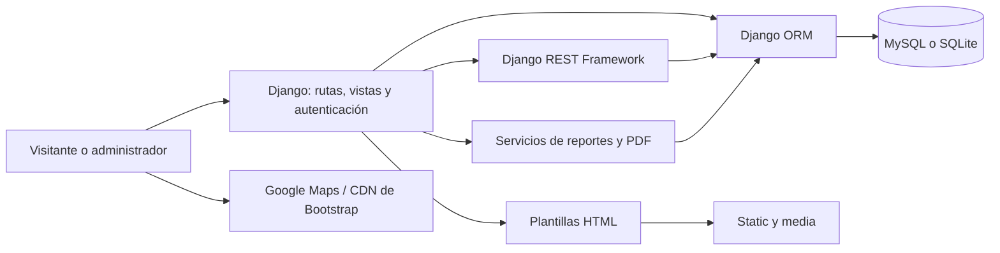
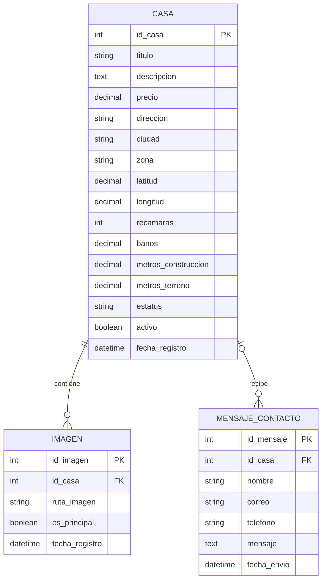

# Multicasa

Multicasa es una aplicación web para publicar y administrar un catálogo de
propiedades inmobiliarias. Permite a los visitantes buscar casas, consultar
fichas con ubicación y fotografías, descargar una ficha técnica en PDF y
contactar a la inmobiliaria. Los usuarios autorizados pueden administrar casas,
imágenes y mensajes, consultar reportes y consumir una API REST.

La aplicación está construida con Django. Las páginas HTML se generan en el
servidor mediante plantillas Django; Django ORM gestiona la persistencia, y
Django REST Framework expone los endpoints JSON para casas.

## Contenido

- [Funciones principales](#funciones-principales)
- [Arquitectura](#arquitectura)
- [Modelo de datos](#modelo-de-datos)
- [Stack tecnológico](#stack-tecnológico)
- [Requisitos previos](#requisitos-previos)
- [Instalación y ejecución local](#instalación-y-ejecución-local)
- [Configuración](#configuración)
- [Rutas de la aplicación](#rutas-de-la-aplicación)
- [API REST de casas](#api-rest-de-casas)
- [Usuarios y permisos](#usuarios-y-permisos)
- [Pruebas](#pruebas)
- [Integración continua](#integración-continua)
- [Archivos estáticos y multimedia](#archivos-estáticos-y-multimedia)
- [Operación y despliegue](#operación-y-despliegue)
- [Estructura del repositorio](#estructura-del-repositorio)

## Funciones principales

### Sitio público

- Página de inicio con carrusel, navegación, contenido informativo y buscador.
- Catálogo público de casas activas en venta.
- Búsqueda por ciudad o zona, estatus, precio mínimo y máximo, recámaras y
  baños. La ciudad y la zona se buscan sin distinguir mayúsculas/minúsculas.
- Tarjetas de propiedades con precio, ubicación, características e imagen
  principal cuando está disponible.
- Ficha de detalle con información de la casa, galería de imágenes, mapa y
  enlace al formulario de contacto.
- Mapa de resultados con coordenadas de las casas encontradas. Al seleccionar
  otra propiedad se actualiza el mapa y el enlace externo.
- Descarga de una ficha técnica PDF con información de la propiedad y, si
  existen, sus fotografías.
- Formulario de contacto que guarda el mensaje y permite asociarlo con una casa
  disponible.
- Búsqueda/autocompletado de casas en el formulario de contacto.
- Diseño adaptable a móvil, tablet y escritorio.

### Administración

- Dashboard con indicadores de propiedades, rangos de precio y estatus.
- Altas, consultas, edición y eliminación de casas, imágenes y mensajes.
- Búsqueda y paginación en las listas de gestión.
- Control de acceso con inicio de sesión, requisito de usuario staff y permisos
  de modelo de Django.
- Acceso adicional al sitio administrativo estándar de Django en `/admin/`.

### API

- API JSON versionada para listar, consultar, crear, modificar y eliminar casas.
- Lecturas públicas de casas activas; las operaciones de escritura requieren
  acceso de administrador.

## Arquitectura

El proyecto utiliza el patrón **MTV de Django** (Model, Template, View), una
variante del patrón MVC:

1. El navegador realiza una solicitud HTTP.
2. El enrutador de Django dirige la solicitud al view correspondiente.
3. El view consulta o modifica modelos mediante Django ORM y prepara el contexto.
4. Para páginas web, Django renderiza una plantilla HTML. Para la API, Django
   REST Framework serializa los datos como JSON.
5. El navegador recibe la respuesta y utiliza CSS/JavaScript para la interacción
   visual, por ejemplo el carrusel, el autocompletado y los marcadores del mapa.



### Responsabilidad de los módulos

| Módulo | Responsabilidad |
|---|---|
| `apps.casas` | Modelos de casas e imágenes, búsqueda pública, detalle, mapa, dashboard general, PDF, serializador y API REST. |
| `apps.contacto` | Formulario público, búsqueda de casas para autocompletar y almacenamiento/envío de mensajes de contacto. |
| `apps.gestion` | Vistas de gestión CRUD y mixins que aplican autenticación, condición de staff y permisos de modelo. |
| `apps.reportes` | Servicio de agregación de datos, dashboard de reportes y listado filtrable. |
| `apps.usuarios` | Inicio y cierre de sesión y redirección después de autenticar. |
| `multicasa` | Configuración global, rutas raíz y puntos de entrada WSGI/ASGI. |

Las plantillas se encuentran en `templates/`, los estilos y recursos de frontend
en `static/`, y los archivos subidos o servidos como contenido multimedia en
`media/`.

## Modelo de datos

La aplicación mantiene tres modelos de negocio principales:



- Una casa puede tener varias imágenes. Cada imagen pertenece a una casa; si la
  casa se elimina, sus registros de imagen se eliminan en cascada.
- Un mensaje puede relacionarse opcionalmente con una casa. Si esta se elimina,
  el mensaje se conserva y su relación con la casa queda vacía.
- Los estatus admitidos para una casa son `en_venta` y `vendida`. `activo`
  controla si la propiedad se ofrece en las vistas públicas y en la API.
- El modelo valida precio positivo y rangos válidos de latitud, longitud y baños.
- Se utilizan índices en ciudad, estatus, precio y relaciones relevantes.

El esquema de la base de datos se versiona mediante las migraciones de Django
ubicadas en `apps/*/migrations/`.

## Stack tecnológico

| Área | Tecnología |
|---|---|
| Lenguaje del backend | Python 3.13 |
| Framework web | Django 6.1.3 |
| API REST | Django REST Framework 3.18.3 |
| Persistencia | Django ORM |
| Base de datos local por defecto | SQLite |
| Base de datos configurable/CI | MySQL; el workflow usa MySQL 8.4 |
| Procesamiento de imágenes y PDF | Pillow |
| Frontend | Plantillas Django, HTML, CSS y JavaScript |
| Framework visual | Bootstrap 5.3.3 servido desde jsDelivr |
| Pruebas de navegador | Playwright con Chromium |
| Integración continua | GitHub Actions |

Las versiones de dependencias Python están fijadas en `requirements.txt`; las de
Node.js/Playwright se definen en `package.json` y `package-lock.json`.

## Requisitos previos

- Python 3.13.
- `pip` y `venv` (incluidos normalmente con Python).
- Node.js y npm para instalar y ejecutar Playwright. El CI utiliza Node.js 22.
- MySQL 8 o compatible si se desea ejecutar con MySQL; SQLite se utiliza por
  defecto cuando `DB_ENGINE` no está configurado.
- Chromium instalado mediante Playwright para las pruebas de navegador.

## Instalación y ejecución local

Los siguientes comandos están escritos para PowerShell en Windows desde la
carpeta raíz del repositorio.

### 1. Crear y activar el entorno Python

```powershell
python -m venv .venv
.\.venv\Scripts\Activate.ps1
```

Si PowerShell bloquea la activación del entorno, revisa la política de ejecución
local o ejecuta los comandos usando directamente `.\.venv\Scripts\python.exe`.

### 2. Instalar dependencias

```powershell
python -m pip install --upgrade pip
python -m pip install -r requirements.txt
```

### 3. Configurar el entorno

```powershell
Copy-Item .env.example .env
```

Edita `.env` según la [configuración](#configuración) que utilizarás. Para
desarrollo rápido se puede omitir `.env`: la aplicación usa SQLite por defecto.

### 4. Crear tablas y usuario administrativo

```powershell
python manage.py migrate
python manage.py createsuperuser
```

### 5. Iniciar el servidor local

```powershell
python manage.py runserver
```

Abre <http://127.0.0.1:8000/>. El servidor de desarrollo no debe usarse como
servidor de producción.

### Comandos Django de utilidad

```powershell
python manage.py check
python manage.py makemigrations --check --dry-run
python manage.py showmigrations
python manage.py createsuperuser
```

## Configuración

El archivo `multicasa/settings.py` intenta cargar variables desde `.env` en la
raíz y también permite definirlas en el entorno del proceso. Las variables
reconocidas son:

| Variable | Descripción | Valor de ejemplo/desarrollo |
|---|---|---|
| `DJANGO_SECRET_KEY` | Clave secreta de Django. Debe ser privada y única en producción. | `change-me-for-production` en la configuración local de ejemplo. |
| `DJANGO_DEBUG` | Activa/desactiva el modo debug. | `True` local; `False` en producción. |
| `DJANGO_ALLOWED_HOSTS` | Hosts permitidos, separados por comas. | `localhost,127.0.0.1` |
| `DB_ENGINE` | Motor configurado: `mysql`/`mariadb`; cualquier otro valor selecciona SQLite. | `mysql` para MySQL; omitir para SQLite. |
| `DB_NAME` | Nombre de la base MySQL. | `multicasa_db` |
| `DB_USER` | Usuario MySQL. | `root` en desarrollo local. |
| `DB_PASSWORD` | Contraseña MySQL. | Definir un valor privado. |
| `DB_HOST` | Host MySQL. | `127.0.0.1` |
| `DB_PORT` | Puerto MySQL. | `3306` |
| `EMAIL_BACKEND` | Backend de correo Django. | Consola local de Django si se omite. |
| `DEFAULT_FROM_EMAIL` | Remitente y dirección receptora de los avisos del formulario. | `no-reply@multicasa.local` |

Ejemplo mínimo para MySQL:

```env
DJANGO_SECRET_KEY=reemplaza-por-una-clave-privada
DJANGO_DEBUG=True
DJANGO_ALLOWED_HOSTS=localhost,127.0.0.1
DB_ENGINE=mysql
DB_NAME=multicasa_db
DB_USER=root
DB_PASSWORD=tu_password
DB_HOST=127.0.0.1
DB_PORT=3306
```

Para SQLite, no definas `DB_ENGINE=mysql`; Django utilizará `db.sqlite3` en la
raíz del repositorio. El formulario de contacto guarda el mensaje en la base de
datos e intenta enviar una notificación mediante el backend configurado. El
backend predeterminado en desarrollo imprime los mensajes en la consola.

**No guardes `.env`, claves ni contraseñas en Git.** El archivo `.env` está
ignorado por `.gitignore`; `.env.example` solo debe contener valores de ejemplo.

## Rutas de la aplicación

| Ruta | Acceso | Descripción |
|---|---|---|
| `/` | Público | Inicio, catálogo en venta y buscador. |
| `/casas/<id>/` | Público | Detalle de una casa activa. |
| `/casas/<id>/ficha-pdf/` | Público | Descarga de ficha técnica PDF de una casa activa. |
| `/contacto/` | Público | Formulario de contacto. |
| `/contacto/casas/buscar/?q=<texto>` | Público | Autocompletado JSON de casas activas en venta. |
| `/login/` | Público | Inicio de sesión. |
| `/logout/` | Usuario autenticado | Cierre de sesión por POST. |
| `/dashboard/` | Usuario staff | Dashboard integrado de gestión. |
| `/gestion/casas/` | Staff con permisos | Gestión de casas. |
| `/gestion/imagenes/` | Staff con permisos | Gestión de imágenes. |
| `/gestion/mensajes/` | Staff con permisos | Gestión de mensajes. |
| `/reportes/` | Usuario staff | Dashboard analítico. |
| `/reportes/exportar/` | Usuario staff | Listado de casas con filtro opcional por estatus. |
| `/api/v1/casas/` | Lectura pública; escritura de administrador | API REST de casas. |
| `/api/v1/casas/<id>/` | Lectura pública; escritura de administrador | Operaciones sobre una casa. |
| `/admin/` | Usuario con acceso al admin Django | Administración estándar de Django. |

### Formulario y autocompletado de contacto

El formulario puede relacionar el mensaje con una casa disponible. El endpoint de
búsqueda recibe `q`, considera búsquedas de al menos dos caracteres, limita el
texto de búsqueda y devuelve como máximo diez resultados. La selección de la casa
se valida en el servidor antes de guardar el mensaje.

### Reportes

El dashboard agrega propiedades por estatus y por rangos de precio:

- Económica: hasta $1,000,000 MXN.
- Media: de $1,000,001 a $2,500,000 MXN.
- Residencial: más de $2,500,000 MXN.

El listado de reportes permite filtrar por `en_venta` o `vendida`. La agregación
del servicio incluye por defecto todos los registros, también los inactivos; la
opción de contar solo activos está disponible en el servicio para sus
consumidores internos.

## API REST de casas

La API está implementada mediante un `ModelViewSet` y un `DefaultRouter` de
Django REST Framework. Las respuestas se renderizan como JSON.

| Método | Endpoint | Permiso | Resultado |
|---|---|---|---|
| `GET` | `/api/v1/casas/` | Público | Lista casas activas. |
| `GET` | `/api/v1/casas/<id>/` | Público | Consulta una casa activa; una casa inexistente o inactiva devuelve `404`. |
| `POST` | `/api/v1/casas/` | Usuario administrador (`is_staff`) | Crea una casa. |
| `PUT` | `/api/v1/casas/<id>/` | Usuario administrador (`is_staff`) | Reemplaza/actualiza una casa. |
| `PATCH` | `/api/v1/casas/<id>/` | Usuario administrador (`is_staff`) | Actualiza parcialmente una casa. |
| `DELETE` | `/api/v1/casas/<id>/` | Usuario administrador (`is_staff`) | Elimina la casa. |

Ejemplo de lectura:

```powershell
Invoke-RestMethod -Uri "http://127.0.0.1:8000/api/v1/casas/"
```

Ejemplo de cuerpo JSON para crear o actualizar una casa:

```json
{
  "titulo": "Casa en Saltillo",
  "descripcion": "Casa de tres recámaras",
  "precio": "1850000.00",
  "direccion": "Calle de ejemplo 123",
  "ciudad": "Saltillo",
  "zona": "Centro",
  "latitud": "25.4383000",
  "longitud": "-100.9737000",
  "recamaras": 3,
  "banos": "2.0",
  "metros_construccion": "180.00",
  "metros_terreno": "220.00",
  "estatus": "en_venta",
  "activo": true
}
```

La respuesta contiene los campos serializados de la casa, incluido su `id` y
`fecha_registro`; estos dos campos son de solo lectura. Para probar operaciones
de escritura se necesita autenticarse como usuario staff. Las lecturas y
escrituras de la API se prueban en `tests/unit/casas/test_api.py`.

## Usuarios y permisos

- Django maneja usuarios, contraseñas, sesiones y permisos.
- El inicio de sesión está disponible en `/login/`. Los usuarios staff van al
  dashboard; las cuentas no staff regresan al sitio público.
- Las vistas de gestión requieren autenticación, que el usuario sea staff y el
  permiso correspondiente al modelo.
- El acceso a `/admin/` está sujeto a las reglas de administración de Django.
- La API permite lecturas públicas y limita escrituras a usuarios staff.
- El cierre de sesión se realiza mediante un formulario POST con protección CSRF.

Después de crear un superusuario, concede a los usuarios de gestión únicamente
los permisos de modelo que necesiten desde el admin de Django. `is_staff` por sí
solo no concede todos los permisos del CRUD de gestión.

## Pruebas

### Pruebas Django

Desde la raíz del proyecto:

```powershell
python manage.py test tests
```

El test runner crea una base de datos aislada para la ejecución. Las pruebas
cubren modelos y validaciones, vistas públicas, búsqueda, permisos, CRUD,
autenticación, API, persistencia, mapa, PDF, reportes y dashboard.

Para ejecutar un módulo o archivo concreto:

```powershell
python manage.py test tests.unit.casas
python manage.py test tests.unit.test_crud_auth_api_security
```

### Pruebas de navegador y responsividad

Instala las dependencias JavaScript y el navegador una vez:

```powershell
npm ci
npx playwright install chromium
```

Ejecuta Playwright:

```powershell
npm run test:e2e
```

La configuración de Playwright inicia `runserver` automáticamente y lo detiene
al finalizar. Las pruebas cubren la navegación de inicio, búsqueda, acceso
administrativo anónimo, rechazo de credenciales incorrectas y ausencia de
desbordamiento horizontal en anchos móvil (375 px), tablet (768 px) y escritorio
(1440 px).

Para abrir el navegador y observar la ejecución:

```powershell
npm run test:e2e:headed
```

Los reportes HTML de Playwright se generan en `playwright-report/` y los
resultados detallados en `test-results/`. Estos directorios están excluidos de
Git. Consulta `tests/e2e/` para las pruebas y la configuración.

## Integración continua

El workflow `.github/workflows/ci.yml` se ejecuta en cada `push` y `pull_request`
dirigido a `main`. Tiene dos jobs:

1. **`django-tests`** usa MySQL 8.4, instala `requirements.txt`, ejecuta
   `manage.py check`, verifica migraciones pendientes, aplica las migraciones y
   corre `python manage.py test tests`.
2. **`browser-tests`** instala Python y Node.js 22, las dependencias del
   proyecto y Chromium; después ejecuta `npm run test:e2e`. Si falla, publica
   los resultados de Playwright como artefacto del workflow.

Los jobs son independientes. Para bloquear un merge cuando CI falla, configura
en GitHub una regla de protección para `main` y marca como requeridos los checks
de Django y navegador que aparecen en la ejecución del workflow.

## Archivos estáticos y multimedia

- `static/css/styles.css`: estilos y reglas de diseño responsivo.
- `static/assets/`: iconos, logotipos, fondos, fotografías y recursos multimedia
  versionados con el código.
- `media/casas/`: imágenes cargadas para los registros del modelo `Imagen`.
- `STATIC_ROOT`: destino de `collectstatic` para despliegues.
- `MEDIA_ROOT`: destino de archivos subidos; por defecto es `media/`.

Bootstrap CSS y JavaScript se cargan desde jsDelivr. El mapa utiliza contenido
incrustado/enlaces de Google Maps. Estas integraciones externas y los recursos
que dependen de Internet pueden no mostrarse si el cliente no tiene conexión.

En producción, configura un servidor de archivos estáticos y almacenamiento
persistente y respaldado para `MEDIA_ROOT`; no dependas del servidor de
desarrollo de Django para servirlos.

## Operación y despliegue

Antes de desplegar:

1. Define `DJANGO_DEBUG=False`, una `DJANGO_SECRET_KEY` nueva y
   `DJANGO_ALLOWED_HOSTS` explícito.
2. Configura una base de datos MySQL administrada y credenciales fuera del
   repositorio.
3. Ejecuta las migraciones con `python manage.py migrate`.
4. Ejecuta `python manage.py collectstatic` y configura un servidor/CDN para los
   archivos estáticos.
5. Configura el backend de correo y valida el flujo de notificaciones.
6. Conserva y respalda los archivos subidos a `MEDIA_ROOT`.
7. Usa un servidor WSGI/ASGI apropiado y HTTPS; `runserver` es solo para
   desarrollo.
8. Revisa las comprobaciones de despliegue de Django con
   `python manage.py check --deploy`.

La configuración disponible define los valores base de desarrollo y CI. Las
cabeceras, cookies seguras y demás ajustes de producción deben revisarse y
configurarse en el entorno de despliegue.

## Estructura del repositorio

```text
.
├── apps/
│   ├── casas/             # Catálogo, modelos, vistas, API y PDF
│   ├── contacto/          # Mensajes y formulario de contacto
│   ├── gestion/           # CRUD privado y control de permisos
│   ├── reportes/          # Dashboard y agregaciones
│   └── usuarios/          # Inicio y cierre de sesión
├── multicasa/             # Settings, URLs y entradas WSGI/ASGI
├── templates/             # Plantillas HTML Django
├── static/                # CSS, JavaScript y assets versionados
├── media/                 # Archivos de imagen cargados
├── tests/
│   ├── unit/              # Pruebas Django
│   └── e2e/               # Pruebas Playwright
├── .github/workflows/     # Integración continua de GitHub Actions
├── manage.py
├── requirements.txt
├── package.json
└── package-lock.json
```

## Notas y límites conocidos

- La base por defecto es SQLite para facilitar el desarrollo local; el CI
  también valida las pruebas Django contra MySQL.
- Las imágenes cargadas deben poder ser abiertas por Pillow para incluirse en
  la galería del PDF.
- Los correos de contacto se guardan en la base de datos. La aplicación intenta
  enviar una notificación; el backend de consola sirve para desarrollo y no es
  un servicio SMTP de producción.
- El proyecto depende de recursos externos de Bootstrap y Google Maps en ciertas
  vistas.
- Los cambios de esquema de base de datos deben realizarse en los modelos y
  registrarse con migraciones de Django.
